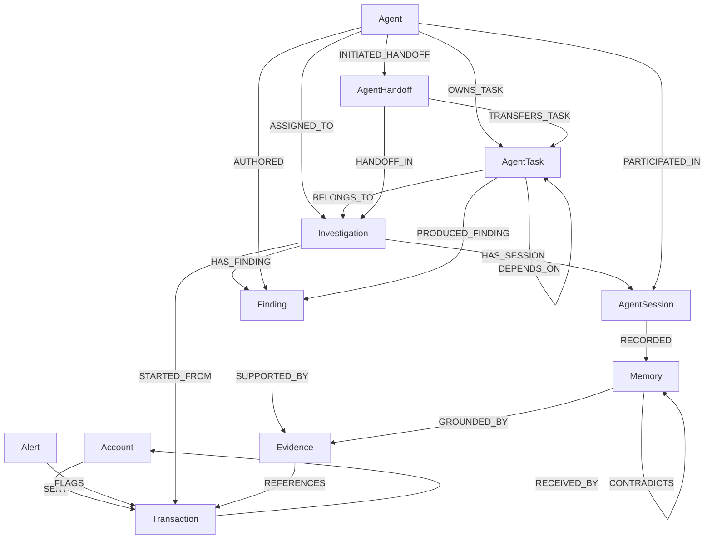

# Money Trail Graph Schema (Schema Version 2)

Source of truth: `src/money_trail/database/graph_schema.py`. This document describes the schema definition, node specs, relationship specifications, indexes, constraints, and the versioned migration mechanism introduced in Phase 5.

## Schema Versioning & Evolution

* Current Schema Version: `2` (defined as `SCHEMA_VERSION = 2` in `graph_schema.py`).
* Durable Migration Storage: Schema version and applied migrations are durably persisted in the FalkorDB graph as `(:SchemaMigration)` nodes.
* Additive Evolution: Migration from Version 1 to Version 2 is non-destructive and strictly additive. All existing financial transactions, accounts, alerts, investigations, findings, and evidence remain completely untouched and valid.

## Graph Model Overview



Text representation of Phase 5 additions:

```text
(Investigation)-[:HAS_SESSION]->(AgentSession)
(AgentSession)-[:RECORDED]->(Memory)
(Agent)-[:PARTICIPATED_IN]->(AgentSession)
(Memory)-[:GROUNDED_BY]->(Evidence)
(Memory)-[:SUPERSEDES]->(Memory)
(Memory)-[:CONTRADICTS]->(Memory)
(Agent)-[:OWNS_TASK]->(AgentTask)
(AgentTask)-[:BELONGS_TO]->(Investigation)
(AgentTask)-[:DEPENDS_ON]->(AgentTask)
(AgentTask)-[:PRODUCED_FINDING]->(Finding)
(Agent)-[:INITIATED_HANDOFF]->(AgentHandoff)
(AgentHandoff)-[:TRANSFERS_TASK]->(AgentTask)
(AgentHandoff)-[:HANDOFF_IN]->(Investigation)
```

## Node Labels & Property Contracts

| Label | Identity Property | Required Properties | Optional Properties | Purpose |
|---|---|---|---|---|
| Account | `account_id` (str) | `account_id` | `dataset`, `created_at` | Financial account node |
| Transaction | `transaction_id` (str) | `transaction_id`, `amount`, `currency`, `timestamp` | `channel`, `reference`, `dataset` | Fund transfer record |
| Alert | `alert_id` (str) | `alert_id`, `created_at` | `alert_type`, `severity`, `source`, `description` | Transaction signal |
| Investigation | `investigation_id` (str) | `investigation_id`, `status` (`open`, `in_progress`, `closed`), `created_at` | `updated_at`, `title` | Persistent investigation record |
| Finding | `finding_id` (str) | `finding_id`, `kind` (`observation`, `hypothesis`, `interpretation`), `statement`, `created_at` | `confidence` | Analytical finding |
| Evidence | `evidence_id` (str) | `evidence_id`, `created_at` | `produced_by_tool`, `query_ref`, `description` | Supporting evidence for findings |
| Agent | `agent_id` (str) | `agent_id`, `role` (`coordinator`, `investigator`, `auditor`, `memory_curator`, `agent`) | `name` | Registered AI agent role |
| **AgentSession** | `session_id` (str) | `session_id`, `investigation_id`, `status` (`active`, `completed`, `interrupted`, `failed`), `started_at` | `completed_at`, `dataset`, `updated_at`, `metadata_json` | Persistent investigation run/session |
| **Memory** | `memory_id` (str) | `memory_id`, `memory_type` (`episodic`, `semantic`), `scope` (`investigation`, `dataset`), `statement`, `status` (`active`, `superseded`, `invalidated`, `revalidation_needed`), `created_at` | `dataset`, `investigation_id`, `updated_at`, `valid_from`, `valid_to`, `provenance_tool`, `rule_fingerprint`, `confidence` | Provenance-aware persistent graph memory |
| **AgentTask** | `task_id` (str) | `task_id`, `task_type`, `status` (`pending`, `ready`, `running`, `completed`, `blocked`, `failed`, `cancelled`), `investigation_id`, `created_at` | `session_id`, `assigned_role`, `assigned_agent_id`, `attempt_count`, `idempotency_key`, `updated_at`, `completed_at`, `result_summary`, `error_detail` | Durable task for multi-agent DAG coordination |
| **AgentHandoff** | `handoff_id` (str) | `handoff_id`, `investigation_id`, `task_id`, `source_agent_id`, `target_role`, `status` (`initiated`, `transferred`, `accepted`, `completed`, `failed`, `rejected`), `created_at` | `target_agent_id`, `reason`, `context_summary`, `idempotency_key`, `updated_at`, `completed_at` | Structured context & task transfer between agents |
| **SchemaMigration** | `version` (int) | `version`, `description`, `applied_at`, `status` | none | Durable graph record of applied migrations |

## Relationships

| Type | Direction | Purpose | Core (v1) / Additive (v2) |
|---|---|---|---|
| SENT | Account -> Transaction | Transfer debited source account | Core |
| RECEIVED_BY | Transaction -> Account | Transfer credited destination account | Core |
| FLAGS | Alert -> Transaction | Alert flagged transfer | Core |
| STARTED_FROM | Investigation -> Transaction | Investigation entry anchor | Core |
| HAS_FINDING | Investigation -> Finding | Finding recorded in investigation | Core |
| SUPPORTED_BY | Finding -> Evidence | Evidence backing analytical claim | Core |
| REFERENCES | Evidence -> Transaction | Concrete transaction linked to evidence | Core |
| ASSIGNED_TO | Agent -> Investigation | Agent assigned to case | Non-core |
| AUTHORED | Agent -> Finding | Author attribution of finding | Non-core |
| **HAS_SESSION** | Investigation -> AgentSession | Investigation has persistent sessions | Additive (v2) |
| **RECORDED** | AgentSession -> Memory | Session recorded memory item | Additive (v2) |
| **PARTICIPATED_IN** | Agent -> AgentSession | Agent role active in session | Additive (v2) |
| **GROUNDED_BY** | Memory -> Evidence | Semantic memory grounded in graph evidence | Additive (v2) |
| **SUPERSEDES** | Memory -> Memory | Replacement memory supersedes obsolete memory | Additive (v2) |
| **CONTRADICTS** | Memory -> Memory | Explicit contradiction between claims | Additive (v2) |
| **OWNS_TASK** | Agent -> AgentTask | Agent ownership of task | Additive (v2) |
| **BELONGS_TO** | AgentTask -> Investigation | Task associated with investigation | Additive (v2) |
| **DEPENDS_ON** | AgentTask -> AgentTask | Prerequisite dependency between tasks | Additive (v2) |
| **PRODUCED_FINDING**| AgentTask -> Finding | Task output finding | Additive (v2) |
| **INITIATED_HANDOFF**| Agent -> AgentHandoff | Agent initiated handoff | Additive (v2) |
| **TRANSFERS_TASK** | AgentHandoff -> AgentTask | Handoff transfers task context | Additive (v2) |
| **HANDOFF_IN** | AgentHandoff -> Investigation | Handoff scoped to investigation | Additive (v2) |

## Constraints & Range Indexes

FalkorDB enforces range indexes and constraints on node properties:
* **Range Indexes**: Built on all node identity properties (`account_id`, `transaction_id`, `alert_id`, `investigation_id`, `finding_id`, `evidence_id`, `agent_id`, `session_id`, `memory_id`, `task_id`, `handoff_id`, `version`), plus query-traversal properties `Transaction.timestamp`, `Investigation.status`, `AgentTask.status`, and `Memory.created_at`.
* **Unique Node Constraints**: Enforced on every node identity property.
* **Mandatory Node Constraints**: Enforced on all required properties defined in the schema registry.

## Migration Mechanism (`money_trail.database.migration`)

The migration runner:
1. Queries FalkorDB for existing `(:SchemaMigration)` records to determine the active schema version.
2. If no migration records exist, inspects the graph for existing v1 tables/nodes. If present, records baseline v1.
3. Applies pending migrations sequentially in non-destructive transactions.
4. Creates new range indexes and constraints in safe dependency order.
5. Emits durable `(:SchemaMigration {version: 2, status: 'completed'})` node.
6. Is safe to execute repeatedly (idempotent no-op when already current).
