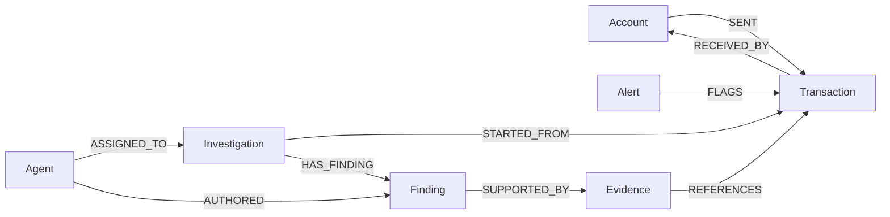

# Money Trail graph schema (schema version 1)

Source of truth: `src/money_trail/database/graph_schema.py`. This document describes exactly what that
module defines and what `money-trail-init` creates. Tests in `tests/unit/test_schema_definitions.py` keep the
code self-consistent.

## Model



Text form:

```text
(Account)-[:SENT]->(Transaction)-[:RECEIVED_BY]->(Account)
(Alert)-[:FLAGS]->(Transaction)
(Investigation)-[:STARTED_FROM]->(Transaction)
(Investigation)-[:HAS_FINDING]->(Finding)-[:SUPPORTED_BY]->(Evidence)-[:REFERENCES]->(Transaction)
(Agent)-[:ASSIGNED_TO]->(Investigation)        (added, see below)
(Agent)-[:AUTHORED]->(Finding)                 (added, see below)
```

A transfer is modelled as a Transaction node between two Account nodes (rather than an Account-to-Account
edge) so that alerts, investigations and evidence can point at the individual transfer, and so multi-hop
paths alternate Account / Transaction / Account.

## Conventions

* Identity: every node has one string identity property, unique in the graph. Display names are never identities.
* Namespacing: datasets do not share an identifier namespace. The future ingestion pipeline must supply
  already-namespaced identifiers (for example `<dataset>:<source id>`). The schema does not generate them.
* Timestamps: integer epoch milliseconds, UTC.
* Money: `Transaction.amount` is a non-negative integer in minor currency units (cents, paise);
  `currency` is a required ISO 4217 code. No floating point money.
* Unknown properties are rejected by `GraphStore` before any write.

## Nodes

| Label | Identity | Required | Optional | Purpose |
|---|---|---|---|---|
| Account | `account_id` (str) | `account_id` | `dataset` (str), `created_at` (int) | A financial account. No owner or personal identity assumed. |
| Transaction | `transaction_id` (str) | `transaction_id`, `amount` (int >= 0), `currency` (str), `timestamp` (int) | `channel`, `reference`, `dataset` (str) | One transfer of funds. |
| Alert | `alert_id` (str) | `alert_id`, `created_at` (int) | `alert_type`, `severity`, `source`, `description` (str) | A signal attached to a transaction. No generation rules exist yet. |
| Investigation | `investigation_id` (str) | `investigation_id`, `status` (open, in_progress, closed), `created_at` (int) | `updated_at` (int), `title` (str) | Persistent investigation state. |
| Finding | `finding_id` (str) | `finding_id`, `kind` (observation, interpretation, hypothesis), `statement` (str), `created_at` (int) | `confidence` (float in [0, 1]) | An analytical statement. `kind` keeps facts, interpretations and open hypotheses distinct. |
| Evidence | `evidence_id` (str) | `evidence_id`, `created_at` (int) | `produced_by_tool`, `query_ref`, `description` (str) | A record supporting a finding, traceable to the tool/query that produced it. |
| Agent | `agent_id` (str) | `agent_id`, `role` (str) | `name` (str) | A future AI participant. No agents are implemented. |

## Relationships

| Type | Direction | Purpose | Properties |
|---|---|---|---|
| SENT | Account -> Transaction | Account originated the transfer | none |
| RECEIVED_BY | Transaction -> Account | Transfer credited the account | none |
| FLAGS | Alert -> Transaction | Alert refers to the transfer | none |
| STARTED_FROM | Investigation -> Transaction | Investigation entry point | none |
| HAS_FINDING | Investigation -> Finding | Finding recorded in the investigation | none |
| SUPPORTED_BY | Finding -> Evidence | Evidence backing the finding | none |
| REFERENCES | Evidence -> Transaction | Transaction record the evidence points to | none |
| ASSIGNED_TO (added) | Agent -> Investigation | Agent participates in the investigation | `assigned_at` (int) |
| AUTHORED (added) | Agent -> Finding | Provenance of a finding across agents | `authored_at` (int) |

The two added relationships exist only to cover the stated Track 2 need (agent assignment and participation);
they are marked `core=False` in the code.

## Indexes and constraints actually created

Verified on FalkorDB module build 41803 with client `falkordb==1.8.0`:

* 9 node range indexes: one on each of the 7 identity properties, plus `Transaction.timestamp` (time-ordered path
  queries) and `Investigation.status` (resuming open investigations).
* 7 UNIQUE node constraints, one per identity property. FalkorDB requires the matching index first, and
  initialization creates indexes before constraints.
* 18 MANDATORY node constraints, one per required property in the tables above.

Total: 9 indexes and 25 constraints; `money-trail-init` reports these counts on first run and zero on later runs.

## Phase 2 status

Phase 2 (ingestion and queries) reuses this schema without any change; `SCHEMA_VERSION` remains 1. Ingestion
populates Account, Transaction and Alert nodes and the `SENT`, `RECEIVED_BY` and `FLAGS` relationships only.
`Account.dataset` and `Transaction.dataset` carry the dataset namespace; alerts are namespaced through their
identifier. See `../data-ingestion.md`.

## Phase 3 status

Phase 3 (detection engine) also reuses this schema without change; `SCHEMA_VERSION` remains 1. It writes `Investigation`, `Finding` and
`Evidence` nodes with the existing properties (`Finding.kind` is `observation` or `hypothesis`; `confidence` is never set) and the
`STARTED_FROM`, `HAS_FINDING`, `SUPPORTED_BY` and `REFERENCES` relationships. Identifiers are deterministic hashes (see `../detection.md`).
`Agent` nodes and the `ASSIGNED_TO` and `AUTHORED` relationships remain unused. No pattern or evaluation label is stored on any node.

## Limitations and behaviour worth knowing

* Constraints and indexes are on nodes only. No relationship constraints or indexes exist, so duplicate edges
  between the same pair are prevented by `GraphStore` (it uses MERGE), not by the database.
* Type, range and vocabulary rules (for example `amount >= 0`, `Finding.kind`) are enforced by Python validation
  in `graph_schema.validate_*`, not by the database. FalkorDB constraints cover uniqueness and presence only.
* FalkorDB checks mandatory constraints when a node is created, so `GraphStore.upsert_node` supplies every
  property in the CREATE statement instead of MERGE-then-SET.
* Creating a unique constraint on a graph that already contains duplicates fails. Initialization then raises
  `SchemaError` and deletes nothing.
* Labels are never removed from FalkorDB's label list: after initialization of a new graph `CALL db.labels()` also
  shows the bootstrap label `__schema_bootstrap__`. No node carries it.
* The graph key only exists once something is written. Initialization of a new graph writes and deletes one marker
  node with a label outside the schema.
* Schema changes after version 1 are not automated. `SCHEMA_VERSION` is defined in code but is not yet stored in
  the graph.

## How this supports later phases

* Multi-hop tracing: the Account / Transaction / Account alternation supports path traversal; the integration
  suite already runs a four-hop evidence trace (Investigation to Finding to Evidence to Transaction to Account).
* Evidence tracing: every Finding reaches Transactions only through Evidence, and Evidence records the producing
  tool and query.
* Persistent context and coordination: Investigation, Finding and Agent nodes live in the same graph as the
  transactions, so a later agent can resume an investigation by querying it.
