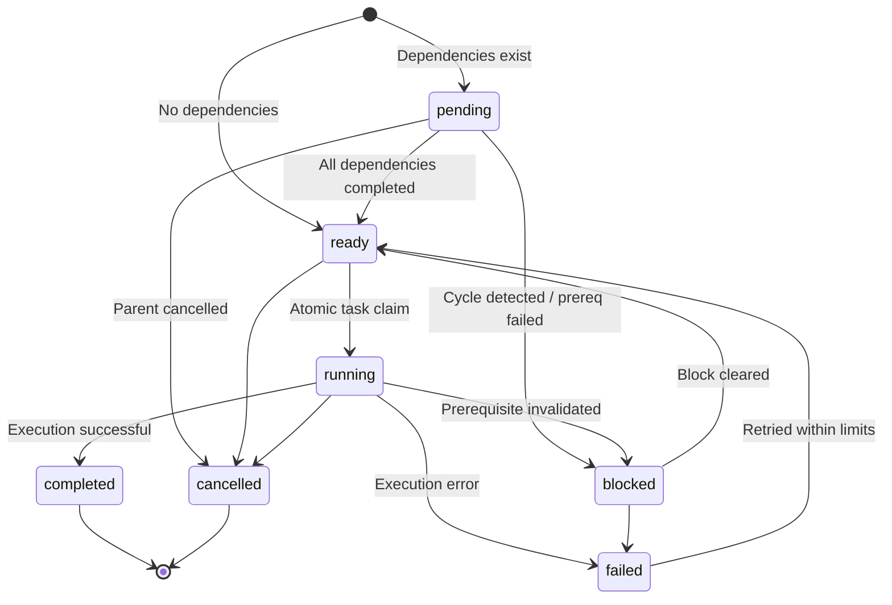
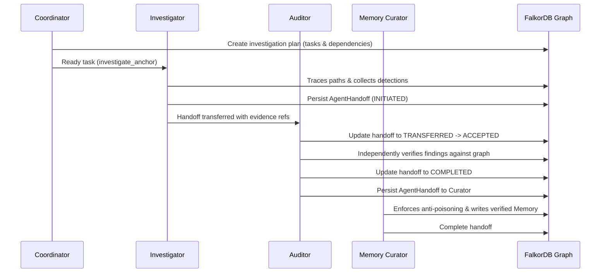

# Multi-Agent Graph Coordination in Money Trail (Phase 5)

## Overview

Money Trail coordinates specialized agent roles through a shared, persistent task and state graph stored in FalkorDB. Rather than relying on central in-memory queues or independent message brokers, the graph is the authoritative coordination layer: it dictates which tasks are eligible to run, which prerequisites are missing, who owns each task, and what evidence was handed off.

## Specialized Agent Roles

| Role Name | Identifier | Permitted Responsibilities | Allowed Operations |
|---|---|---|---|
| **Coordinator / Planner** | `coordinator` | Reads graph state and memories; generates bounded DAG task plans; queries ready tasks; reconciles interrupted runs. | Creates tasks, verifies dependencies, schedules execution. Cannot invent detector findings. |
| **Graph Investigator** | `investigator` | Executes read-only account / transaction graph queries; traces money paths; runs deterministic detectors. | Executes Phase 4 agent tools; traces graph patterns; collects evidence. |
| **Evidence Auditor** | `auditor` | Independently audits findings against FalkorDB graph; verifies transaction existence, amounts, and dates; rejects fabricated claims. | Deterministic verification of finding-to-evidence and evidence-to-transaction edges. |
| **Memory Curator** | `memory_curator` | Reads audited findings; records episodic memories; enforces anti-poisoning safeguards before promoting semantic facts. | Curates episodic and semantic graph memories; links evidence; records supersession. |

## Task State Machine (`AgentTask`)



### Allowed Transitions
* `pending` -> `ready`, `blocked`, `cancelled`
* `ready` -> `running`, `blocked`, `cancelled`
* `running` -> `completed`, `failed`, `blocked`, `cancelled`
* `blocked` -> `ready`, `failed`, `cancelled`
* `failed` -> `ready` (retry), `cancelled`
* `completed` -> Terminal state
* `cancelled` -> Terminal state

## Dependency DAG & Scheduling

1. **Acyclic Verification**: Every task creation evaluates `detect_dependency_cycle`. Plans with cyclic dependencies are rejected immediately.
2. **Graph-Driven Readiness**: A task is eligible to run (`status='ready'`) ONLY when all tasks it points to via `[:DEPENDS_ON]` have `status='completed'`.
3. **Automatic Unblocking**: When a task completes in FalkorDB (`complete_task`), dependent tasks whose prerequisites are now satisfied are automatically unblocked to `ready`.

## Atomic Task Claiming & Concurrency Guarantees

In FalkorDB, task claiming is executed atomically via a single parameterized Cypher update:
```cypher
MATCH (t:AgentTask {task_id: $tid})
WHERE t.status = 'ready'
SET t.status = 'running', t.assigned_agent_id = $agent_id,
    t.attempt_count = $attempts, t.updated_at = $now
RETURN count(t)
```
If two workers attempt to claim the same task simultaneously, only one worker matches `t.status = 'ready'`; the other worker receives `count(t) = 0` and is rejected with a `ValidationError`. This guarantees single-worker execution without duplicate runs.

## Persistent Agent Handoffs (`AgentHandoff`)

Handoffs represent auditable transfers of context, findings, and tasks between agents:



## Session Recovery After Interruption

If an investigation process terminates abruptly:
1. All completed tasks, sessions, and findings remain safe in FalkorDB.
2. A new process invokes `MultiAgentOrchestrator.resume_investigation(session_id)`.
3. The session state is transitioned from `interrupted` back to `active`.
4. The coordinator queries FalkorDB for the next ready tasks whose dependencies are completed.
5. Work resumes without repeating already completed tasks.

## Baseline Comparison Metrics

The coordinated workflow was benchmarked against an uncoordinated sequential baseline:
* **Dependency Conflicts**: Reduced from >0 to **0** in coordinated execution.
* **Redundant Duplicate Calls**: Completely eliminated (**0**) through idempotent task keys and FalkorDB status checks.
* **Resumption Time**: Instantaneous context recovery from graph nodes without full replay.

## CLI Usage

```bash
# List tasks in an investigation
python -m money_trail.cli task list --investigation-id inv_demo_1

# Check blockers for a task
python -m money_trail.cli task blockers task_1234567890

# List handoffs across roles
python -m money_trail.cli handoff list --investigation-id inv_demo_1

# Audit agent participation and actions
python -m money_trail.cli audit inv_demo_1

# Resume an interrupted session
python -m money_trail.cli session resume sess_1234567890
```
